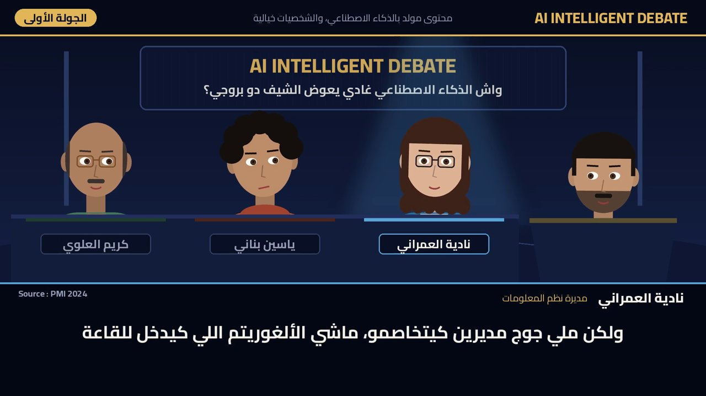

# IA Debate — skill Claude



**IA Debate** produit des capsules vidéo de l'émission *AI Intelligent Debate* : un débat télévisé joué par des agents IA, en darija marocaine, avec sources vérifiées (méthode Fhamator), voix ElevenLabs et vidéo du dessin animé 2D au photoréaliste.

Le skill est libre de téléchargement mais **nécessite un code d'activation** : un code active une seule conversation Claude. La procédure complète et le kit sont servis après activation, toujours à jour.

## Installation

**claude.ai (web, desktop, mobile)** : téléchargez [`ia-debate.zip`](ia-debate.zip) (bouton *Download*), sans le décompresser, puis dans Claude : *Personnaliser > Skills > + > Créer un skill > Importer un skill*.

**Claude Code** :

```bash
git clone https://github.com/mzakariarahmouni-web/ia-debate ~/.claude/skills/ia-debate
```

## Utilisation

Dans une nouvelle conversation : « Lance IA Debate ». Le skill envoie le manuel d'usage en PDF, demande le code d'activation, puis guide pas à pas.

Manuel : [`IA_Debate_Manuel.pdf`](IA_Debate_Manuel.pdf)

## Prérequis

- Abonnement Claude payant avec l'exécution de code activée.
- Domaines autorisés dans Claude (*Paramètres > Capacités*) : `aid-licence.m-zakariarahmouni.workers.dev`, `storage.googleapis.com`, `api.elevenlabs.io`.
- Compte ElevenLabs payant relié à Claude.
- Un code d'activation, fourni par l'éditeur.

Contenu généré par IA, personnages fictifs. La publication reste sous la responsabilité de l'utilisateur.
